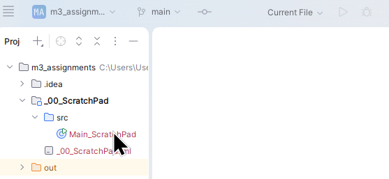

# Modul 3: Objektorientierte Programmierung

| KW | Themen                                                                                                  |
|----|---------------------------------------------------------------------------------------------------------|
| 47 | Einführung OOP: Klassen vs Objekte/Instanzen, Attribute & Methoden, Konstruktoren                       |
| 48 | UML-Klassendiagramme, Kapselung: Zugriffsmodifikatoren, Getter & Setter, (Projekte in IntelliJ anlegen) |
| 49 | Wiederholung, Übungen                                                                                   |
| 50 | Vererbung                                                                                               |
| 51 | Übungen, KLAUSUR                                                                                        |

## Ordnerstruktur
In diesem Repository wird sich Ihr Workflow ein wenig ändern.

Jede Übung ist ein kleiner Projektordner und stellt _eine_ Applikation dar,
die ab jetzt aus mehreren Java-Dateien bestehen kann.
Alle Java-Dateien für die Übung sind in dem `src/` Ordner zu finden (src = "source").
Starten Sie immer die `main`-Methode in der Java-Datei die mit `Main_` beginnt.

Wenn Sie die App auf diese Art einmal gestartet haben, sollte die Übung auch oben in der Leiste
neben dem grünen Playbutton mit aufgelistet werden. Diese Methode in dieser
Datei dient jetzt immer als Startpunkt Ihrer Applikation (in der jeweiligen Übung).

> Per Konvention heißt diese Datei (und die Klasse) normalerweise `Main`.
> Leider wird genau diese Bezeichnung in der Run-Auflistung in der oberen Leiste
> genau so angezeigt. Das ist wenig hilfreich, weshalb wir in diesem Repository
> vorerst auf diese Konvention verzichten.
